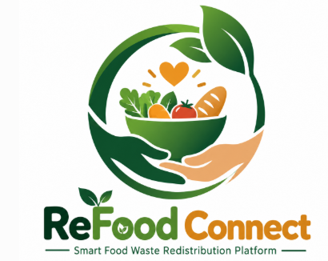
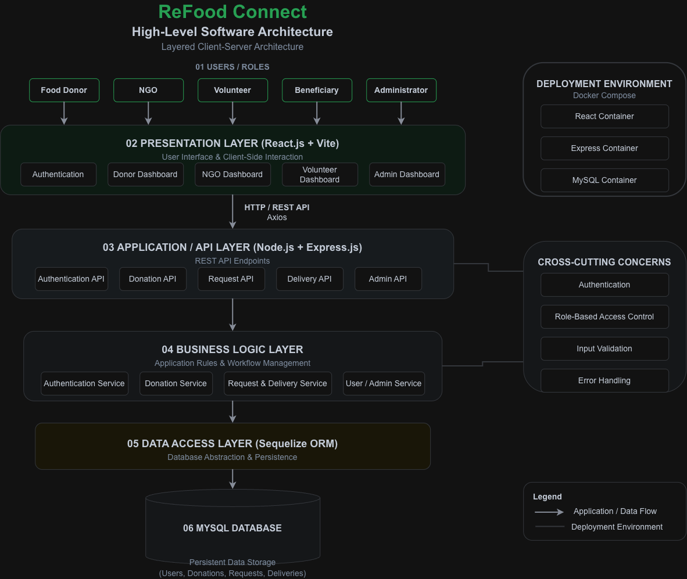

<p align="center">
  
</p>

<h1 align="center">ReFood Connect</h1>

<p align="center">
  <strong>Smart Food Waste Redistribution Platform</strong><br>
  <em>Connecting food donors with NGOs and volunteers to eliminate hunger and reduce food wastage.</em>
</p>

<p align="center">
  
  
  
  
</p>

---

## 📌 Project Overview

**ReFood Connect** is a centralized web platform designed to tackle the growing issue of urban food waste and food insecurity. Every day, large quantities of edible surplus food from restaurants, banquet halls, supermarkets, and events are discarded, while charitable organizations and shelters struggle to source regular meals.

ReFood Connect bridges this logistical gap by connecting **Food Donors** with verified **NGOs & Food Banks**, and coordinating **Volunteers** to handle transport and delivery in real-time.

---

## 👥 Key Features & User Roles

Our platform provides customized interfaces and workflows for five distinct user roles:

- 🍽️ **Food Donors**: List surplus food batches with details on quantity, food type, expiry time, and pickup address. Track donation status from pickup through final delivery.
- 🏢 **NGOs / Food Banks**: Discover available food donations within their vicinity, submit instant claim requests, and manage food distribution to communities in need.
- 🚴 **Volunteers**: View nearby transport requests, accept pickup tasks, and update delivery statuses (*Available → Requested → Accepted → Picked Up → Delivered*).
- 🤝 **Beneficiaries**: Shelters, orphanages, and community kitchens that receive nutritious surplus meals through partnered NGOs.
- 🛡️ **Administrators**: System-wide governance, verifying participating organizations, monitoring redistribution audit logs, and tracking platform metrics.

---

## 🏗️ System Architecture & Design

ReFood Connect implements a **Layered Client-Server Architecture** using the Service Layer pattern to ensure high modularity, low coupling, and maintainability.

<p align="center">
  
</p>

### Core Architectural Layers:
1. **Presentation Layer**: Built with React.js and Vite, providing responsive, role-based dashboards for Donors, NGOs, Volunteers, and Admins.
2. **API & Routing Layer**: Express.js REST API handling HTTP request routing, input validation, and role-based access control (RBAC).
3. **Business Logic Layer**: Dedicated services (`authService`, `donationService`, `adminService`) that encapsulate business rules and enforce a strict finite state machine for donations.
4. **Data Access Layer**: Sequelize ORM abstracting database operations, parameterized queries, and model associations.
5. **Database Persistence**: MySQL 8.0 storing structured user accounts, donation batches, audit trails, and delivery records.

---

## 💻 Tech Stack

| Component | Technologies |
|---|---|
| **Frontend** | React.js, Vite, React Router, Axios, CSS3 |
| **Backend** | Node.js, Express.js, JWT (JSON Web Tokens), Bcrypt.js |
| **Database & ORM** | MySQL 8.0, Sequelize ORM |
| **DevOps & Containers** | Docker, Docker Compose |
| **Testing** | Jest, Supertest, SQLite (in-memory test harness) |
| **UI/UX Design** | Figma, Draw.io |

---

## 🚀 Getting Started

### Prerequisites
- [Docker Desktop](https://www.docker.com/products/docker-desktop/) (recommended) **OR** [Node.js](https://nodejs.org/) (v18+) and [MySQL](https://www.mysql.com/)

### 1. Clone the Repository
```bash
git clone https://github.com/ChiragAsija1323/ReFood-Connect.git
cd ReFood-Connect
```

### 2. Run with Docker Compose (Recommended)
The entire application stack (Frontend, Backend, and MySQL database) can be started with a single command:

```bash
docker compose up --build
```

- **Frontend Client:** [http://localhost:5173](http://localhost:5173)
- **Backend API:** [http://localhost:8000](http://localhost:8000)

---

### Manual Local Setup (Without Docker)

#### Backend Setup
```bash
cd server
npm install
# Configure database settings in server/.env
npm start
```

#### Frontend Setup
```bash
cd client
npm install
npm run dev
```

---

## 🧪 Testing

The backend includes an automated test suite covering user authentication, donation lifecycle transitions, role-based authorization, and database persistence.

```bash
cd server

# Run all test suites
npm test

# Run regression tests
npm run test:regression
```

---

## 📁 Project Structure

```text
ReFood-Connect/
├── client/                 # React.js frontend application
│   ├── public/             # Static assets (brand logo, icons)
│   └── src/
│       ├── api/            # Centralized Axios HTTP client
│       ├── pages/          # Role dashboards (Donor, NGO, Volunteer, Admin, Auth)
│       ├── App.jsx         # Client routing
│       └── App.css         # Styling & responsive design
├── server/                 # Node.js & Express.js backend API
│   ├── config/             # Database connection & Sequelize setup
│   ├── controllers/        # Request & response controllers
│   ├── middleware/         # JWT authentication & RBAC middleware
│   ├── models/             # Sequelize data models (User, Donation)
│   ├── routes/             # REST API endpoint definitions
│   ├── services/           # Core business logic & state machines
│   └── __tests__/          # Integration and regression test suites
├── design/                 # Architecture diagrams and UI wireframes
├── docs/                   # System design & requirements documentation
├── docker-compose.yml      # Multi-container Docker orchestration
└── README.md
```

---

## 👥 Authors & Contributors

Developed by:
* **Chirag Asija** ([@ChiragAsija1323](https://github.com/ChiragAsija1323))
* **Saanvi Gupta**

**Vellore Institute of Technology (VIT), Chennai**
